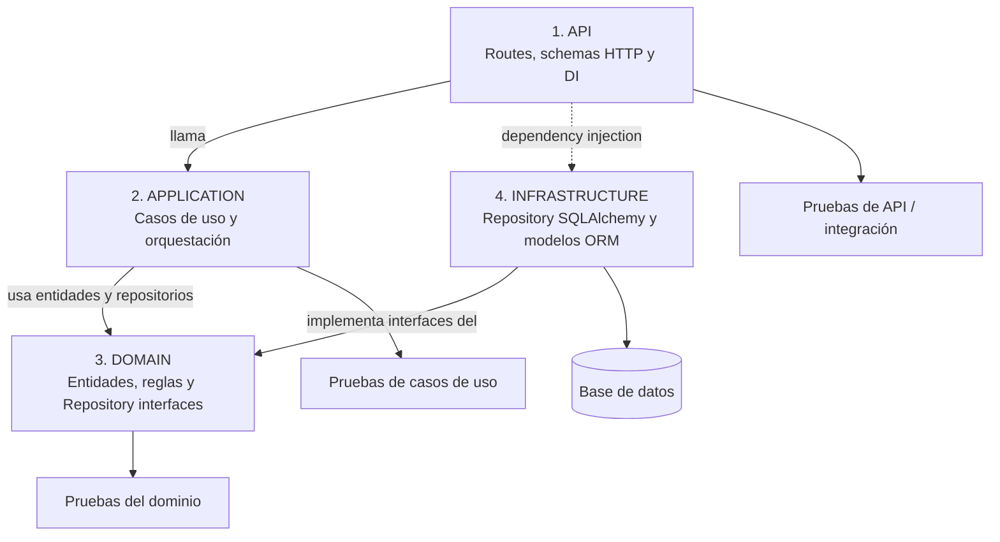

# CrudFastAPI

Small reference project demonstrating how to build a **scalable backend API** using:

- **FastAPI**
- **Domain-Driven Design (DDD)**
- **Test-Driven Development (TDD)**
- **Clean Architecture principles**

The project is designed for **educational purposes** and as a **starting point for real-world applications** involving multiple domains (e.g. customers, users, orders).

## 🎯 Project goals

- Show how to structure a FastAPI project using **DDD principles**
- Keep the **domain layer independent** from frameworks
- Apply **SOLID principles** and **dependency inversion**
- Build a **fully testable application**
- Ensure tests are **100% repeatable and isolated**

## 🧱 Architecture overview

The project follows a layered architecture inspired by **DDD** and **Hexagonal Architecture (Ports & Adapters)**:

```
API (FastAPI)
└── Application (Use Cases)
└── Domain (Entities & Interfaces)
└── Infrastructure (DB, ORM, external services)
```

### Layers

- **Domain**
  - Entities
  - Business rules
  - Repository interfaces
  - No dependency on FastAPI or SQLAlchemy

- **Application**
  - Use cases (commands & queries)
  - Orchestrates domain logic

- **Infrastructure**
  - SQLAlchemy models
  - Repository implementations
  - Database configuration

- **API**
  - FastAPI routers
  - Request / response schemas
  - Dependency injection

---

The domain layer is completely independent from FastAPI and SQLAlchemy.

## 📁 Project structure

```
src/
├── customers/
│ ├── api/
│ ├── application/
│ ├── domain/
│ └── infrastructure/
├── users/
│ ├── api/
│ ├── application/
│ ├── domain/
│ └── infrastructure/
├── infrastructure/
│ └── db/
├── main.py
tests/
├── api/
├── application/
├── domain/
├── fakes/
```

## ⚙️ Requirements

- Python >= 3.14
- Poetry

## 📦 Installation

Install Poetry if you don't have it:

```
pip install poetry
```

Install project dependencies:

```
poetry install
```

## ▶️ Running the application

Run the API in development mode:

```
poetry run uvicorn src.main:app --reload
```

The API will be available at:

http://127.0.0.1:8000

Swagger UI: http://127.0.0.1:8000/docs

## 🧪 Testing strategy

The project follows TDD and includes:

- Unit tests
    - Domain logic
    - Application use cases
- Integration tests
    - FastAPI endpoints
- In-memory SQLite database for tests
    - Tests do NOT use the application database
    - Database is created and destroyed per test
    - Tests are fully repeatable

Run all tests:

```
poetry run pytest
```

Tests are isolated and can be executed multiple times without affecting the application database.

## 🚧 Project status
This project is under active development and is intended for learning and experimentation with:

- DDD
- Clean Architecture
- FastAPI best practices
- Automated testing

## 🔧 Guía técnica DDD por feature

Cada feature del proyecto representa un dominio independiente dentro de `src/`, por ejemplo `customers`, `users` u `orders`. Debe mantener esta estructura:

```text
src/<feature>/
├── domain/          # Reglas de negocio y contratos
├── application/     # Casos de uso del feature
├── infrastructure/  # Adaptadores técnicos, base de datos y repositorios
└── api/             # Rutas y contratos HTTP
```

### Flujo de trabajo recomendado



> Las flechas representan la dirección práctica del trabajo. Las dependencias reales deben apuntar hacia el dominio: infraestructura implementa sus interfaces y la API configura qué implementación se inyectará.

### 1. Domain: definir el problema

Empieza aquí para implementar o modificar reglas del negocio.

- Crea o modifica entidades en `domain/`.
- Añade las reglas y errores propios del dominio.
- Define interfaces de repositorio como contratos, sin usar FastAPI ni SQLAlchemy.
- No coloques aquí HTTP, Pydantic, sesiones de base de datos ni modelos ORM.

Ejemplo conceptual:

```text
customer.py              -> entidad y reglas de Customer
customer_repository.py   -> contrato CustomerRepository
errors.py                -> errores del dominio
```

### 2. Tests del dominio

Escribe primero las pruebas de comportamiento y reglas:

```text
tests/domain/test_<feature>.py
```

Ejecuta las pruebas hasta que la entidad y sus reglas sean claras. La entidad no debe conocer cómo se guarda ni dónde provienen sus datos.

### 3. Application: crear casos de uso

Después define en `application/` una operación por caso de uso:

- `create_<feature>.py`
- `get_<feature>.py`
- `list_<feature>.py`
- `update_<feature>.py`
- `deactivate_<feature>.py`

Un caso de uso recibe una interfaz de repositorio, ejecuta reglas del dominio y devuelve entidades o datos definidos por el dominio.

No debe importar clases HTTP como `APIRouter`, `HTTPException` ni esquemas Pydantic.

Escribe también sus pruebas unitarias usando un repositorio falso:

```text
tests/application/test_create_<feature>.py
tests/fakes/in_memory_<feature>_repository.py
```

### 4. Infrastructure: conectar la persistencia

Implementa en `infrastructure/` los detalles técnicos:

- Modelos SQLAlchemy, normalmente bajo `infrastructure/db/models.py`.
- Implementaciones concretas de repositorios.
- Conversión entre entidades del dominio y modelos ORM.
- Configuración de sesión o engine compartido.

La implementación debe cumplir la interfaz creada en `domain/`:

```text
CustomerRepository (domain)
        ↑ implementa
SqlAlchemyCustomerRepository (infrastructure)
```

Ejemplo de dependencia invertida:

```python
class SqlAlchemyCustomerRepository(CustomerRepository):
    # Implementación concreta con SQLAlchemy
    pass
```

### 5. API: exponer el feature

Por último, crea o modifica el controlador HTTP en `api/`:

- Declara rutas y métodos HTTP con `APIRouter`.
- Define payloads y responses Pydantic en `schemas/` o `api/schemas/`.
- Obtiene el repositorio por dependency injection.
- Instancia el caso de uso correspondiente.
- Traduce errores del dominio a respuestas HTTP.
- No implementes reglas de negocio en el endpoint.

Ejemplo de flujo en un endpoint:

```text
HTTP request
    ↓
Router FastAPI
    ↓
Schema Pydantic: valida el payload
    ↓
Dependency injection: obtiene el repositorio
    ↓
Caso de uso: orquesta la operación
    ↓
Entidad y reglas del domain
    ↓
Implementación SQLAlchemy del repository
    ↓
Base de datos
    ↓
HTTP response
```

Es recomendable mantener separados los contratos de transporte y la lógica:

```text
src/<feature>/schemas/<feature>.py  # payload y response HTTP
src/<feature>/api/<feature>.py     # rutas y coordinación HTTP
```

### 6. Pruebas de API e integración

Termina con pruebas de los endpoints en:

```text
tests/api/test_<feature>_api.py
```

Usa una base SQLite temporal o el repositorio falso cuando sea suficiente, según la responsabilidad que se quiera probar.

### Orden resumido para crear un feature nuevo

1. Crear la carpeta `src/<feature>/` con `domain`, `application`, `infrastructure`, `api` y, si hace falta, `schemas`.
2. Escribir las entidades y reglas en `domain/`.
3. Crear las interfaces de repositorio en `domain/`.
4. Escribir pruebas de dominio.
5. Crear los casos de uso en `application/`.
6. Escribir pruebas de casos de uso con repositorios en memoria.
7. Crear los modelos y la implementación SQLAlchemy en `infrastructure/`.
8. Crear schemas y rutas HTTP en `api/` y `schemas/`.
9. Registrar el router en `src/main.py`.
10. Escribir las pruebas de API.
11. Ejecutar la suite completa con `poetry run pytest`.

### Convenciones prácticas

- Cada carpeta comienza desde el dominio y trabaja hacia afuera.
- Las dependencias internas apuntan hacia `domain`.
- La API conoce casos de uso e infraestructura solamente para composición y dependency injection.
- Los casos de uso conocen interfaces del dominio, no implementaciones SQLAlchemy.
- Las implementaciones SQLAlchemy conocen el dominio para adaptar entidades y persistencia.
- Si dos features necesitan compartir comportamiento, considera un módulo compartido solo después de confirmar que realmente pertenece a ambos; evita acoplarlos por conveniencia.

---

The domain layer is completely independent from FastAPI and SQLAlchemy.